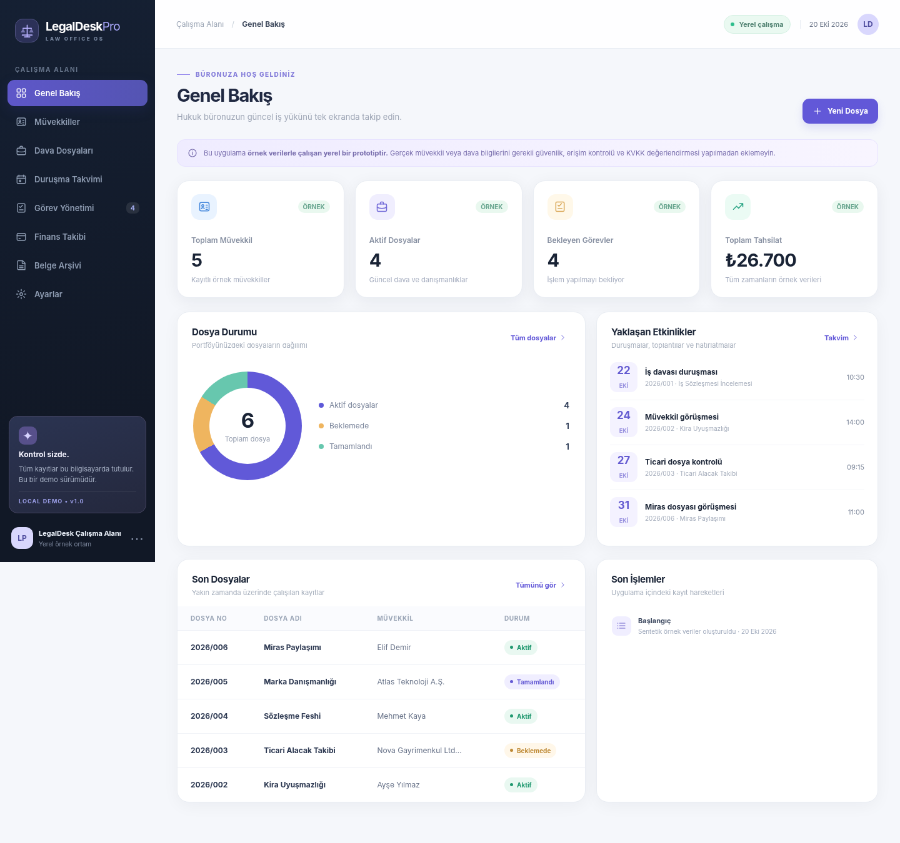
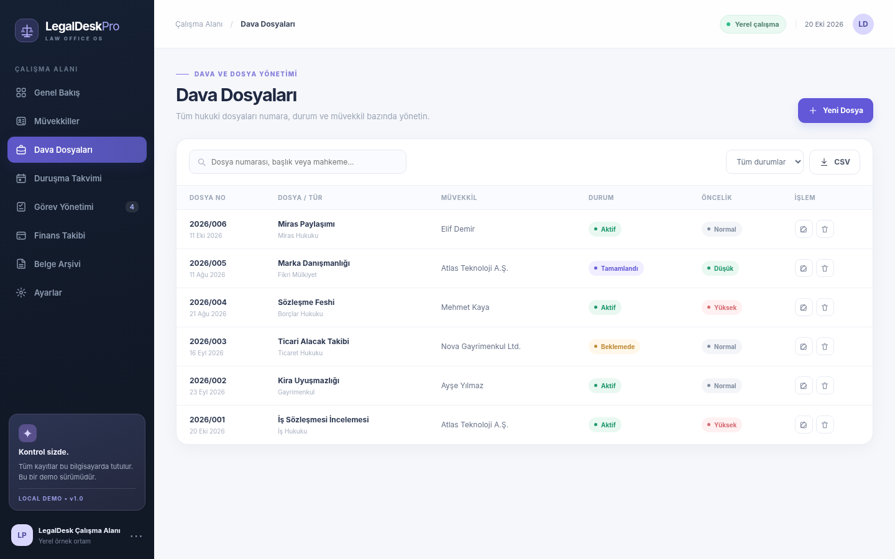

# ⚖️ LegalDesk Pro

**Modern, local-first law office management prototype** / **Yerel çalışan hukuk bürosu yönetim uygulaması**



> [!WARNING]
> **Demo / Portfolio Project — NOT suitable for real legal-client data.**
> This project intentionally ships without user authentication, encryption at rest, role-based access, encrypted backups or a production security review. Do not store real client identities, litigation material or privileged documents. Do not expose it to the public Internet.
>
> **Bu sürüm bir portföy demosudur.** Gerçek müvekkil bilgileri, dava dosyaları veya avukatlık sırrı niteliğindeki belgeler için kullanılmamalıdır. Bu işlevler henüz güvenlik ve KVKK/mesleki gizlilik açısından değerlendirilmemiştir.

## ✨ Özellikler / Features

| Modül | Özellikler |
|---|---|
| 📊 Genel Bakış | KPI'lar, dosya durum grafiği, yaklaşan etkinlikler, son hareketler |
| 👥 Müvekkiller | Bireysel/kurumsal kişi kayıtları, iletişim, arama, düzenleme ve silme |
| ⚖️ Dava Dosyaları | Dosya numarası, müvekkil, mahkeme, tür, durum, öncelik, CSV dışa aktarma |
| 📆 Takvim | Duruşma/görüşme/hatırlatma, aylık görünüm, kayıt yönetimi |
| ✅ Görevler | Görev ekleme, tamamlama, durum/öncelik ve dosya bağlama |
| 💳 Finans | Tahsilat ve masraf kaydı, net bakiye, altı aylık tahsilat eğilimi |
| 📁 Belgeler | PDF, DOCX, JPG, PNG, TXT yükleme/indirme/silme, dosyaya bağlama (5 MB) |
| 🔎 Kullanılabilirlik | Global yan menü, modül içi arama, mobil uyumlu düzen, Türkçe arayüz |



## 📤 GitHub’a yükleme / Publish to GitHub

Mac’te `GitHub-Yukle.command` dosyasını Terminal ile çalıştırarak `muratpalak/LegalDesk-Pro` herkese açık deposunu oluşturup kodu yükleyebilirsiniz. `GITHUB_YUKLEME_TALIMATI.txt` dosyasına bakın. Gerçek müvekkil verilerini yüklemeyin.

```bash
cd ~/Downloads/LegalDesk-Pro
bash GitHub-Yukle.command
```

## 🚀 Quick start / Hızlı başlangıç

### macOS
1. ZIP dosyasını çıkarın.
2. **`start_mac.command`** dosyasını çift tıklayın. macOS dosyayı engellerse Terminal'de aşağıdaki komutu çalıştırın:

```bash
cd ~/Downloads/LegalDesk-Pro
chmod +x start_mac.command
./start_mac.command
```

### Windows 10/11
1. [Python 3.10+](https://www.python.org/downloads/) kurun. Kurulumda *Add Python to PATH* seçeneğini etkinleştirin.
2. ZIP dosyasını çıkarın ve **`start_windows.bat`** dosyasına çift tıklayın.

### Linux / Manual

```bash
cd LegalDesk-Pro
python3 -m venv .venv
source .venv/bin/activate
pip install -r requirements.txt
python -m uvicorn app.main:app --host 127.0.0.1 --port 8765
```

**Open / Açın:** http://127.0.0.1:8765

> İlk kurulum için internet bağlantısı gerekir (`pip install`). Sonraki kullanımlarda dosyalar yerel kalır. Sunucu Terminal/CMD penceresi açık olduğu sürece çalışır; kapatmak için Ctrl+C.

## 🛠️ Tech stack

- **Backend:** Python 3.10+, FastAPI, Pydantic, SQLite (stdlib).
- **Frontend:** Dependency-free HTML, CSS, JavaScript (responsive, zero build step).
- **Storage:** Local SQLite and document files inside `app/data/` (excluded by `.gitignore`).
- **API docs:** [http://127.0.0.1:8765/api/docs](http://127.0.0.1:8765/api/docs).
- **Database:** Tables include `clients`, `cases`, `events`, `tasks`, `transactions`, `documents`, `activities`.

**Architecture note:** This lightweight local prototype intentionally does **not** include React or PostgreSQL yet. A React/TypeScript frontend and PostgreSQL-backed multi-user edition are possible future iterations after access controls are designed and tested.

## 🧪 Tests

```bash
pip install pytest httpx
pytest -q
```

## 🧭 Roadmap

- [x] Core CRUD and sample dataset
- [x] Multi-module responsive dashboard
- [x] Case CSV export
- [x] Document upload/download with basic checks
- [ ] Proper user authentication, role-based authorization and CSRF protection
- [ ] Encryption at rest, encrypted backups and secure audit trails
- [ ] Dedicated PostgreSQL deployment option with migration strategy
- [ ] React/TypeScript client and multilingual (Turkish/German) interface
- [ ] Authorized document import workflow and access policy
- [ ] Lawyer-verified deadline calculation and legal review workflow
- [ ] Security assessment, privacy impact review and production hardening

## 🔐 Security and data limitations

- Binds to **127.0.0.1** only in the included start scripts. Do not bind to `0.0.0.0`, host publicly, or forward the port.
- Demo records are fictional. They are automatically created on first launch if no clients exist.
- Data and uploads are stored **unencrypted** under `app/data/`.
- **There is no login or access-control system.** Any application able to reach its local HTTP service can access stored records.
- Do not treat the calendar as a legal deadline calculator. Dates are entered manually; no official court source is integrated.
- Do not assume KVKK/GDPR compliance or compliance with attorney-client confidentiality; seek professional legal/security review before any production use.
- This tool is not affiliated with UYAP and does not scrape official court systems.
- Server-side constraints and file-signature checks are **basic safety checks**, not antivirus or production document scanning.

## 📁 Repository structure

```text
LegalDesk-Pro/
├─ app/
│  ├─ __init__.py
│  ├─ db.py              # SQLite schema + fictional dataset
│  └─ main.py            # FastAPI routes and validation
├─ static/
│  ├─ index.html
│  ├─ styles.css
│  └─ app.js
├─ tests/test_api.py
├─ docs/
│  ├─ dashboard-preview.png
│  └─ case-management-preview.png
├─ GitHub-Yukle.command
├─ GITHUB_YUKLEME_TALIMATI.txt
├─ start_mac.command
├─ start_windows.bat
├─ start_linux.sh
├─ requirements.txt
├─ .gitignore
└─ LICENSE
```

## 🇬🇧 Short English summary

LegalDesk Pro is a **portfolio-ready, offline-first demonstration** of a legal case-management product. It offers local CRUD operations for clients, case files, events, tasks, transactions, and documents. Its front end has no package manager dependencies; the API is documented with FastAPI OpenAPI. The entire sample dataset is synthetic. **It is not intended for actual legal practice or privileged data.**

## 📄 License

MIT — see [`LICENSE`](LICENSE).
